# TaskBoard — Full-Stack DevOps Capstone Project

> A production-oriented SaaS task management application demonstrating the **complete software delivery lifecycle**: development → testing → containerization → security scanning → CI/CD → cloud infrastructure → Kubernetes deployment → monitoring → troubleshooting.

---

## Table of Contents

1. [Project Overview](#1-project-overview)
2. [Architecture Diagram](#2-architecture-diagram)
3. [Features](#3-features)
4. [Technology Stack](#4-technology-stack)
5. [Repository Structure](#5-repository-structure)
6. [Prerequisites](#6-prerequisites)
7. [Local Docker Compose Setup](#7-local-docker-compose-setup)
8. [Backend Development Setup](#8-backend-development-setup)
9. [Frontend Development Setup](#9-frontend-development-setup)
10. [Environment Variables](#10-environment-variables)
11. [Database Migrations](#11-database-migrations)
12. [Testing](#12-testing)
13. [Git & GitHub Workflow](#13-git--github-workflow)
14. [Docker Build Instructions](#14-docker-build-instructions)
15. [CI/CD Pipeline](#15-cicd-pipeline)
16. [Trivy Security Scanning](#16-trivy-security-scanning)
17. [GHCR Image Publishing](#17-ghcr-image-publishing)
18. [Terraform AWS Infrastructure](#18-terraform-aws-infrastructure)
19. [AWS EKS Configuration](#19-aws-eks-configuration)
20. [Kubernetes Deployment](#20-kubernetes-deployment)
21. [Helm Operations](#21-helm-operations)
22. [Ingress Configuration](#22-ingress-configuration)
23. [HPA & Load Testing](#23-hpa--load-testing)
24. [Prometheus & Grafana](#24-prometheus--grafana)
25. [Troubleshooting Exercises](#25-troubleshooting-exercises)
26. [Security Considerations](#26-security-considerations)
27. [AWS Cost Management & Cleanup](#27-aws-cost-management--cleanup)
28. [Final Demonstration Checklist](#28-final-demonstration-checklist)
29. [Known Limitations](#29-known-limitations)
30. [Future Improvements](#30-future-improvements)

---

## 01. Application

### Objective

Develop and run the TaskBoard application, verifying that its frontend and backend operate correctly before containerization and deployment.

### Technology Stack

- Frontend: To be verified from the project configuration
- Backend: Python
- Container orchestration: Docker Compose

### Execution

Commands and configuration will be documented after verifying the application's actual startup procedure.

### Verification

The application must start successfully, and its backend health endpoint or an appropriate application request must return a successful response.

### Screenshots

**Application Running**

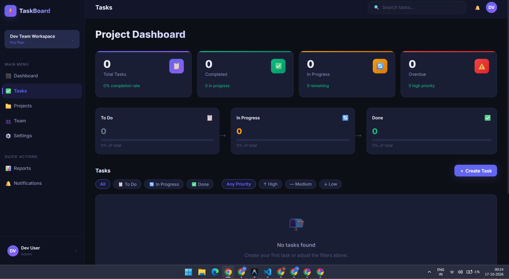

**Application Test**

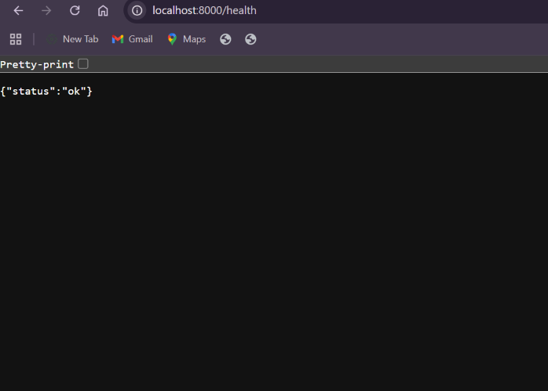

# Stage 2: Git Commit and Version Control

## 2.1 Objective

Use Git to track project changes, create commits, and manage the TaskBoard project's source code using GitHub.

## 2.2 Tools Used

- Git
- GitHub
- PowerShell
- Visual Studio Code

## 2.3 Implementation and Screenshots

### Step 1: Check Git Repository Status

**Command:**

```powershell
git status
```

**Screenshot:** Save the terminal output as `screenshots/02-git-commit/01-git-status.png`.

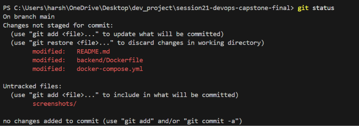

### Step 2: Review Code Changes

**Command:**

```powershell
git diff
```

**Screenshot:** Save the terminal output as `screenshots/02-git-commit/02-git-diff.png`.

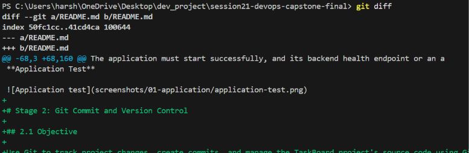

### Step 3: Stage Project Files

**Security check:** Ensure `.env` and other secret files are excluded by `.gitignore` before staging.

**Command:**

```powershell
git add .
```

**Screenshot:** Save the staging/status evidence as `screenshots/02-git-commit/03-git-staging.png`.

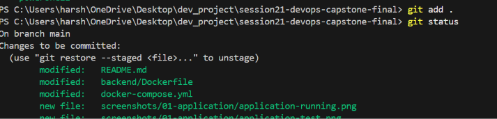

### Step 4: Verify Staged Changes

**Command:**

```powershell
git status
```

**Screenshot:** Save the output showing staged files as `screenshots/02-git-commit/04-staged-status.png`.

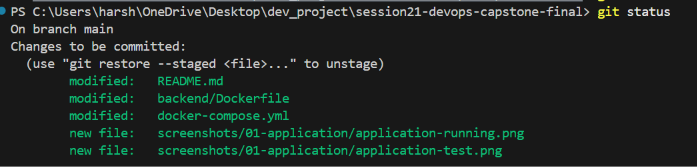

### Step 5: Create a Commit

**Command:**

```powershell
git commit -m "Add TaskBoard DevOps capstone application"
```

**Screenshot:** Save the successful commit output as `screenshots/02-git-commit/05-git-commit.png`.

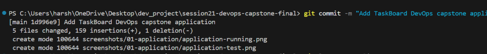

### Step 6: Verify Commit History

**Command:**

```powershell
git log -1 --oneline
```

**Screenshot:** Save the commit hash and message as `screenshots/02-git-commit/06-git-log.png`.

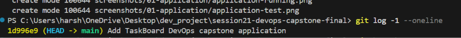

### Step 7: Verify the Current Branch

**Command:**

```powershell
git branch
```

**Screenshot:** Save the active branch output as `screenshots/02-git-commit/07-git-branch.png`.

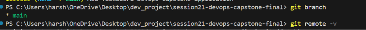

### Step 8: Check Remote Repository

**Command:**

```powershell
git remote -v
```

**Screenshot:** Save the remote configuration output as `screenshots/02-git-commit/08-git-remote.png`.

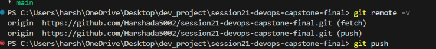

### Step 9: Push Changes to GitHub

**Command:**

```powershell
git push
```

If Git reports that the branch has no upstream, configure the correct upstream before retrying.

**Screenshot:** Save the successful push output as `screenshots/02-git-commit/09-git-push.png`.

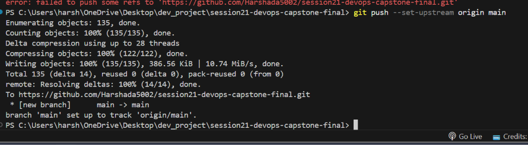

### Step 10: Verify the GitHub Repository

Open the repository in your browser and verify that the committed files are present.

**Screenshot:** Save the GitHub repository page as `screenshots/02-git-commit/10-github-repository.png`.


### Step 11: Verify the Commit on GitHub

Open the repository's commit history and confirm that the pushed commit appears.

**Screenshot:** Save the commit history page as `screenshots/02-git-commit/11-github-commit-history.png`.


## 2.4 Verification Criteria

- The intended project files are committed.
- The commit hash appears in Git history.
- The working tree is clean, except for intentional changes.
- The remote repository is configured when GitHub integration is required.
- The pushed commit is visible on GitHub.

## 2.5 Outcome

This stage documents the Git version-control workflow, from reviewing changes and staging files to creating commits and verifying the remote repository.

All screenshots must be captured from the actual terminal or browser and saved at the specified paths. Images will display automatically in GitHub's README preview once the files are committed and pushed.
